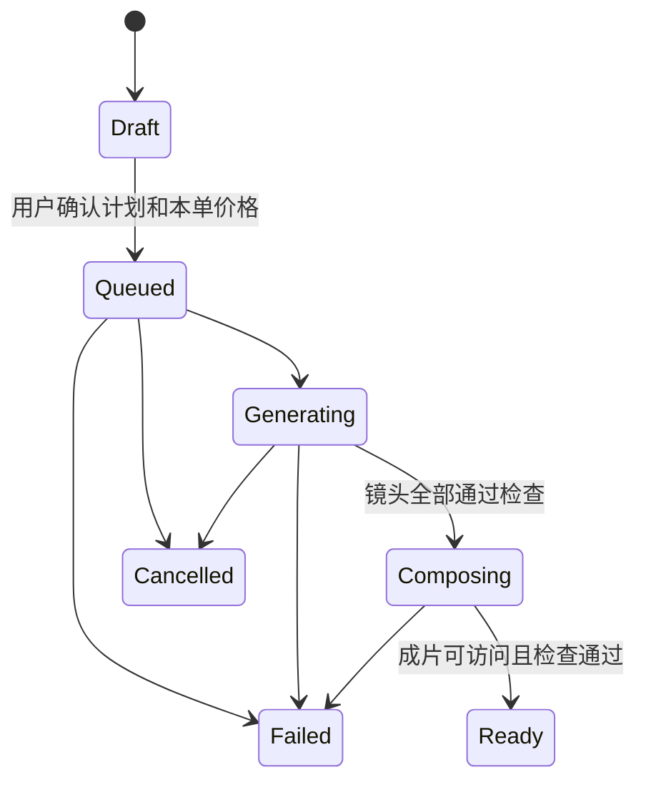

# YUHA 新功能：AI 场景 MV

> **2026-11-26 方向更新**：负责人决定改用 Veo 3.1 Fast、原生 720p 上限。新开发以 [Veo 产品规格](AI_SCENE_MV_VEO_SPEC.md) 为准；本文保留 LTX 方案历史，不再作为模型、默认时长、费用或数据路径的现行依据。尚未实施生产切换。

状态：**产品提案／待评审，尚未上线或完成模型验收**。2026-11-26。
规格基准：master `76022c9`。本次仅整理 feature，不安装模型、不调用真实 GPU、不启用收费或修改隐私条款。

## 1. 一句话与产品决策

**把已经做好的歌，变成一支有 AI 场景、跟随音乐剪辑的 MV。** 用户选风格、描述画面，YUHA 生成少量关键镜头，配上原歌曲、歌词和音乐节奏，导出可分享的视频。

建议先推出 **30 秒竖屏 AI 场景 MV**：默认 4 个短镜头、一个视觉主题、使用原歌曲音轨。先验证“用户愿意分享／付费”和排队成本，再扩展横屏、高清与整首。下面的数量、保留期限及付费规则是建议默认值，实施前纳入规格评审；不是既有服务承诺。

| 选择 | 首版建议 | 原因 |
| --- | --- | --- |
| 核心场景 | 生日祝福、旅行回忆；优先风景、光影、插画等无人脸画面 | 与现有英文／日文增长迭代共用入口，便于展示，降低人物一致性要求 |
| 画面来源 | 文字描述 → 4 个约 4 秒关键镜头，再剪成约 30 秒成片 | 不逐秒生成整首歌；明确会复用镜头，不冒充 30 秒全新连续剧情 |
| 输出 | 9:16、MP4、使用所选歌曲的原音频片段；歌词可开关 | 先把手机生成、保存和分享走通 |
| 生成分辨率 | 实测后选模型原生支持的竖屏尺寸；不沿用横屏参数硬裁 | 保留主体，避免“高清”名不副实；首版不承诺原生 1080p |
| 用户与权限 | 已注册的歌曲所有者；歌曲可播放，私人歌曲同样可用 | 与现有视频权限保持一致，不把许可购买者或持链接的访客当所有者 |
| 模型 | LTX-2.5 是候选实现；产品功能不绑定型号 | 需核实实际版本、权重许可、DGX 兼容性与稳定性，不在产品流程展示部署细节 |

首版不做：整首逐秒生成、人物口型／真人演唱模拟、保证跨镜头人物一致、照片驱动、付费插队、无限量免费生成、完整视频剪辑器、外部视频 API 自动兜底。

## 2. 与现有能力的关系

- **照片 MV**：用户选择照片，现有路径不把照片交给 AI 模型。继续作为优先入口，沿用已提供的免费／不扣歌曲额度规则。
- **AI 场景 MV**：新的可选增强能力，明确标记需要后台生成、可能排队及独立价格／额度。不能悄悄替代照片路径或扩大原勾选的用途。
- **封面视频**：继续作为下方次级入口，也是等待期间的可选快速版本。
- 最新 master 已含照片优先、同屏歌词同步工具、单首重新对齐入口和本机视频保存；直接复用这些能力，不按旧审计重新实现。现有视频保存在设备上的规则，不等于新后台任务已经有云端视频库。
- `deploy/dgx/README.md` 已把音乐服务机器标为 `dgxa`、视频工作机器标为 `dgxv`，并说明当前部署脚本尚未使用后者。本规格倾向视频使用独立资源；文档命名不是部署成功的证据。

## 3. 用户旅程

1. **歌曲页 → 做视频 → AI 场景 MV。** 旁边保留照片 MV 和封面视频。游客说明注册并认领前提。
2. **选歌曲片段。** 默认副歌附近 30 秒，显示起止时间并可试听；歌曲不足 30 秒用实际长度。沿用现有歌词时间版本；估算／待校准时给提示，允许先进入就地同步工具。
3. **选风格、写画面。** 首版建议 3 个经过实测的风格，如雨夜霓虹、日落海边、柔和插画。描述画面不等于重新生成歌词；不要自动把全量歌词、照片或账号资料传给视频模型。
4. **确认镜头计划。** 显示 4 张分镜说明、统一色调／主体与运镜。用户可修改文字，提交后冻结本次计划。说明镜头可能复用、不是口型同步视频。
5. **确认成本与等待。** 展示本单总价／消耗、可取消范围、排队状态及基于实测的预计区间；没有可靠估计时明确未知。按钮写“生成 AI 场景”，不写“免费”“立即完成”，除非本单确实符合。
6. **先看快速预览。** 可以先看现有封面／歌词动效预览；下载 MP4 仍需编码，不承诺点击瞬间就得到文件。清楚标记“快速版”，不把它算成 AI 成片交付。
7. **后台生成关键镜头。** 展示“排队中／正在生成 2/4 个镜头／正在合成”等真实阶段。离开页面、关闭浏览器或断线后，任务继续，回到作品页可恢复查看。
8. **完成后看片。** 原歌曲、歌词与画面按同一个时间轴合成。支持试听预览、下载／系统分享。任务列表显示完成，不默认新增营销邮件或未授权通知。
9. **后续修改。** 修改单个镜头可只重做该镜头；重做费用在确认前说明。只改歌词时间／字幕样式，复用已完成镜头重新合成，不重新花 GPU 生成全部画面。

**渐进生成的边界**：先快版、再镜头预览、最后稳定 AI 成片。首版不自动替换用户已经下载的文件，也不让播放中的视频随后台回写而跳变；各版本可区分，用户明确切换。

## 4. 镜头、音乐与质量规则

- 统一风格、色调、场景元素和运镜范围；首版不承诺人物／物件在所有镜头中完全一致。不要以“不同随机视频拼接”冒充完整叙事。
- 在剪辑点复用镜头或使用轻微裁切／转场，避免频繁突跳。歌曲节拍、段落及歌词边界共同提供候选切点；节拍检测不可靠时按段落或固定镜头长度回退，不能把波形峰值都当作节拍。
- 节拍剪辑只能让**切换**跟随音乐，不能承诺模型画面中的动作、口型和乐器演奏与歌曲精确同步。
- 丢弃模型生成音轨，最终只使用用户选中的歌曲片段；不得混入模型人声、替换原歌、改变音高速度或意外静音。关闭模型音频生成功能是否节省资源需实测，不能由“最后去掉音轨”推断。
- 默认不倒放人物动作；循环、裁切等复用方式应有质量验收。最终时长与选段一致，竖屏不拉伸、主体和字幕在手机安全区内。
- 成片引用歌曲音频、歌词时间和分镜的版本快照。等待期间用户改词／校准／删除歌曲时，有明确的继续、重合成或取消规则，不把旧结果覆盖到新版上。

## 5. 异步任务、可靠性与资源

建议工作流：

- 任务、子镜头、计费及文件状态持久化，不能只放在网页或单进程内存中。重启恢复已完成镜头，重复回调／提交不会重复生成或收费。
- 初始每个视频 GPU worker 并发建议为 1，每用户最多一个活跃视频任务；这是启动限额，不是已测出的设备极限。按实测内存、温度与音乐服务影响调整。
- 默认独立 `dgxv` 执行；若实际共用机器，视频只能在有资源预算时运行，歌曲生成与歌词对齐优先。不能只限制 HTTP 并发，却让多个模型同时占满统一内存。
- 采用有界、公平的镜头队列；长任务按镜头轮转，不能长期占住机器。计入模型切换、预热、失败重试和 ffmpeg 开销。队列满时停止接单／给恢复入口，不收钱后无限等待。
- 同一视频使用多个镜头不等于可以在同机并行。稳定性验证前不出售“优先排队”或承诺时间。
- 子镜头有限重试；失败只补失败镜头，复用已成功结果。整单失败保留可用快版，明确 AI 版未交付。首版不把缺镜头的降级成片静默当成完整付费交付。
- 排队中取消立即生效；运行中取消阻止后续镜头并安全清理，不通过强杀共享模型进程影响其他任务。取消的成本由平台承担，取消单不结算。
- 完成后源歌曲被删除／权限收回，服务端访问与链接同时失效并触发相关资产清理；任何缓存／下载链接都不能绕过所有者权限。已下载到用户设备或转发到第三方的文件无法由 YUHA 远程收回，界面不作相反承诺。

## 6. 定价与容量：先测再定

“本机运行，无第三方视频 API 按次费用”不等于零成本。应计算 GPU 占用、设备折旧、电力、模型加载、存储、下载流量、失败重试和运维成本，以及占用音乐产能的机会成本。

首版建议内测免费但限量；正式推出前按**镜头数量、时长、分辨率形成的工作量**定整单价格，与歌曲生成额度区分。价格进入现有产品／支付矩阵，遵循 `docs/PAYMENTS_DESIGN.md`，不在页面硬编码付款方式。

- 提交前展示固定本单报价；超时重试不临时加价。内部模型失败不收费、不消耗歌曲额度。
- 若采用额度，排队时可暂扣，只有 Ready 且可下载时一次结算；Failed／Cancelled 释放暂扣。禁止同单既结算又释放或重复扣除。
- 用户主动换风格／重做镜头属于新工作量，重新报价确认；修复技术失败不另收费。快版可用不构成 AI 单结算依据。
- 首版先不设免费用户实时生成、高清无限包、付费抢占。后续可分“素材库快版／个性化标准／高清”，但需要各自明确不同体验、价格和可用容量。

### 社区数据只能用于量级估算

以下是用户转述的社区 DGX Spark 数据，**未提供可复核来源与完整参数，本项目未实测**。不能宣传为 YUHA 性能：

| 社区条件 | 转述耗时 | 只据此计算的工作量 |
| --- | --- | --- |
| 768×512，4 秒片段 | 约 1 分钟 | 4 镜头约 4 GPU 分钟；单 worker 理想上限约 15 单／小时，未扣加载、合成、重试 |
| 1280×704，8 秒片段 | 约 3 分钟 | 6 镜头约 18 GPU 分钟；理想上限约 3.3 单／小时，不能当作服务容量承诺 |
| 3 分钟完全独立画面 | 同上两档粗算 | 45 个 4 秒片段约 45 分钟；23 个 8 秒片段约 69 分钟，均不含排队／拼接 |

上表分辨率是横屏样例，不能推出相同竖屏参数性能，也不能直接等同输出质量。首版更需要测 4 个短镜头方案。模板成片时长、独特 AI 镜头秒数、GPU 生成时间应分开记录。

## 7. 隐私与内容授权：图片驱动单独一期

**当前明确边界**：`apps/web/src/pages/Legal.tsx` 的照片说明承诺照片不交 AI、原照片不离开设备，且不持久保存成片。图生视频和后台云端持久任务改变了这些事实，不能沿用现有照片 MV 的提示／勾选就开放。

- 第一阶段只做文字驱动；明确新功能会处理并暂存描述、分镜、生成片段和成片，在开关启用前完成与实际处理一致的条文／产品提示评审。现有照片路径不改变用途。
- 后台功能建议生成片段及成片在私有存储保留 7 天，页面明确过期时间，可提前删除；任务描述与运行资料按审定期限清理。临时编码文件正常完成立即清理、异常最多 24 小时。**这些是拟议期限，需工程／运维／条文确认，未确认前不作承诺。**
- 模型所需数据最小化：文字驱动不收照片；画面生成默认不需整首音频，剪辑服务才读取授权音频。可识别个人的 prompt 不进日志或指标；计数不记录画面正文。
- 自有设备处理是设计目标；仍要核实推理脚本、插件、遥测和服务依赖是否发送用户内容，以及地点与访问权限。未经核实不写“用户数据绝不出公司”。
- 第二阶段图生视频须有独立、清楚的 AI 处理说明、权利和人物影像确认、留存／删除规则。不得自动读取照片 MV 里以前选过的照片或历史封面；私人缓存不跨用户复用。
- 首张参考图可能经过缩放、裁切、颜色和编码处理，不承诺“第一帧与原图逐像素相同”。人物写真、儿童照片、真实名人、口型模拟与身份保持另做产品决策；首版不开放。
- 模型权重、推理代码和可选加速组件的许可证分别核实商用、输出使用及再分发条件；“开源”或“自托管”本身不构成授权结论。素材库只用有权公开复用的素材，不使用用户作品。

## 8. 迭代安排与验收

| 阶段 | 工作 | 完成标准 |
| --- | --- | --- |
| P0 技术验证 | 核实候选 LTX-2.5 官方版本／许可、dgxv 实际部署、纵横屏参数与显存；测试 T2V，I2V 仅使用自有合成素材内部验证 | 有可复核日志与输出，明确支持／不支持、失败原因和成本；不据社区数字宣布上线 |
| P0 体验原型 | 文字分镜、选段、价格说明、快版与后台状态、同屏歌词预览 | 手机能理解“快版”和“AI 版”的区别；退出后能找回任务；只创建原型不默认开始收费 |
| P1 首版内测 | 30 秒竖屏、4 镜头、一个统一风格、异步队列、私有任务文件与导出、故障恢复 | 所有者权限、续看、重复提交、取消、失败返还与重启恢复通过；无模型音轨混入 |
| P2 扩展 | 镜头重做、16:9、60 秒／整首混剪、高清、风格素材库 | 各档实测质量／成本明确；用户知道镜头复用比例；素材来源与使用授权可追溯 |
| P3 图片驱动 | 用户主动选参考图片，单独同意与留存，人物一致性验证 | 条文与实际处理匹配后才开放；不沿用“照片不交 AI”的旧承诺 |

### 测试计划及结果占位

使用自有或合成素材，不使用生产用户照片或歌曲；不因本规格直接对生产 DGX 发测试任务。

- 记录硬件／可用内存、系统／CUDA、模型与权重版本、精度／量化、采样步数、尺寸、帧率、时长、seed 与是否生成模型音频。
- 先冷启动 1 次、每个候选配置暖启动 5 次筛选，再为选中的首版配置至少 30 次收集延迟分布；样本数和失败／OOM 全部报告，不只保留成功样本。报告排队、加载、推理、合成与总时间的 P50/P95。
- 覆盖竖／横屏、简单／复杂画面、4／8 秒、不同风格、取消、重启、超时、并发入队和资源竞争。若隔离为两台机器，验证共用队列／网络依赖仍不拖慢歌曲交付。
- 至少检查 20 条有权使用的歌曲选段及中日英字幕：手机原画质观看、闪烁／主体变形、剪辑节奏、重复感、字幕遮挡、音画时长和只保留原歌曲音轨。
- 真机 iPhone Safari／Android Chrome 验证从入口到任务恢复、预览、下载与保存；截图和桌面模拟不替代完整操作。
- 开发时为任务／计费不变量、所有者访问、缓存隔离、版本快照、取消清理、子镜头重试做行为回归；UI 覆盖新增页面／状态。脚本测试必须在本地隔离库运行。

| 本项目需填结果 | 当前状态 |
| --- | --- |
| 实际模型／版本、部署和可用能力 | 待硬件环境验收；仓库未发现 LTX 视频模型接入 |
| 竖屏 4 秒／8 秒推理 P50/P95、峰值内存、失败率 | 未测试 |
| 4 镜头整单总耗时／GPU 分钟／边际成本 | 未测试 |
| 同时接待人数、排队上限、建议售价 | 依实测确定 |
| 手机导出质量、分享采用率、付费意愿 | 待内测 |

### Feature 成功指标

首要指标是“提交后完成并实际下载／系统分享的 AI MV 比例”，同时跟踪等待中放弃率、技术失败率、单镜头重做率、每支被采用成片的 GPU 成本及付费转化。系统分享面板打开不等于发帖成功，下载也不等于真实发布；不要为了埋点记录用户提示词或照片。

## 9. 工程交接与对外表述

建议独立工作：前端扩展现有 `PhotoVideo.tsx`、作品页与同屏同步工具；API/worker 新增异步视频任务和子镜头，不把分钟级推理塞进现有同步 ffmpeg 请求；providers 封装视频模型；DGX 视频部署单独放目录并显式选择视频主机。具体数据库迁移、接口契约和账本设计另开小规格／TDD 票，禁止修改已应用迁移。

对外候选介绍（仅验收并开放后使用）：

> **YUHA AI 场景 MV**：选一首自己的歌，描述想看到的画面。YUHA 为你生成关键场景，配合歌曲与歌词剪成一支可分享的音乐短片。支持后台制作，完成后回来预览和下载。

部署／数据路径核实前，不使用“已经部署”“零成本”“用户数据不出公司”“一分钟完成”“原图第一帧完全不变”等宣传。本文是产品规格，不是模型评测、法务意见或上线授权。
