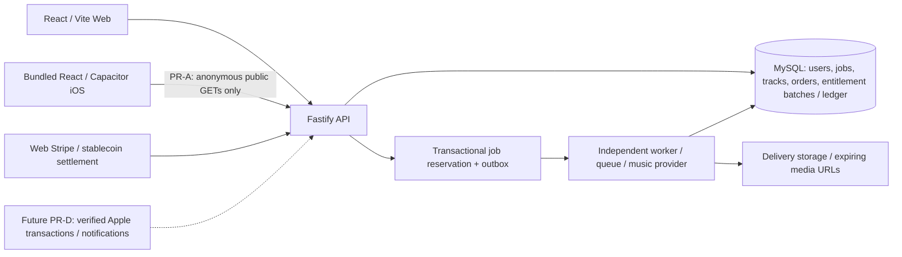

# YUHA iOS · PR-A architecture and route audit

2026-10-25. Implementation base: `master` at `b4cfee4163d97650c988cfc48ca73ecef36a3d98`.
Plan reviewed: [PR #23](https://github.com/lth2015/yuha/pull/23),
`docs/IOS_APP_DEVELOPMENT.md` at `4d25d132f82cea34ff98d4375c970277e1ae09c3`.
That PR is documentation, not an implemented or approved release. This audit
records code facts and implementation decisions; it does not certify contracts,
Apple approval, production credentials or operating-entity disclosures.

## Architecture and shared systems of record

`apps/api/src/server.ts` registers modular auth, generations, tracks, billing,
stablecoin, rights, public, telemetry and admin routes. `packages/contracts`
is the shared API vocabulary. `packages/db/src/ledger.ts` and `billing.ts`
are the existing balance/order system; `apps/api/src/services/payment-methods.ts`
computes the Web payment matrix. The worker and provider adapters remain server
processes; no models, provider credentials or second ledger enter iOS.

Generation reserves units and writes jobs/outbox transactionally; the worker
claims work, calls the provider, verifies/copies audio, and consumes/releases
reservations. Existing job idempotency and server-side concurrency limits must
remain authoritative on mobile. Future Apple event deduplication, product
mapping and refunds need their own server design; current Stripe deduplication
does not constitute Apple support.

## Route and feature matrix

All existing Web routes below keep their current implementation. `IosApp.tsx`
is a separate consumer route tree selected only by the explicit native build.
Unknown paths render a localized unavailable screen; they cannot mount Web
checkout, admin or Web OAuth components. This is an application boundary, not
a substitute for API authorization.

| Actual Web route / feature | iOS PR-A | Required later phase |
| --- | --- | --- |
| `/` | Reuse Home, draft composer, brand and i18n; anonymous; submitting goes to preview sign-in | PR-B: authenticate and enable existing generation API |
| `/auth` | Localized preview status; no passwords, demo users or Google link | PR-B: system-browser OAuth, Apple strategy, Keychain |
| `/auth/google/callback`, `/auth/mfa` | Unavailable | PR-B: native callback/state/session/MFA design |
| `/library` | Private-library status; no fake works or account reads | PR-B: same user-scoped tracks and jobs |
| `/create` | Unavailable | PR-B: reuse advanced creation after authenticated writes are safe |
| `/song/:id` | Unavailable; home showcase can be displayed, detail is not enabled | PR-B/C: owner/public permissions and native audio |
| `/tracks/:id/export`, `/tracks/:id/license` | Unavailable | PR-C: authorized export, Files and Share Sheet |
| `/pricing` | Unavailable; no replacement prices | PR-D: verified StoreKit products |
| `/checkout/confirm`, `/checkout/complete`, `/checkout/stablecoin`, `/checkout/simulate` | Unavailable; no Stripe, JPYC, USDC, NETX or demo checkout | PR-D: StoreKit flow; Web routes stay Web |
| `/settings/billing` | Unavailable; no Stripe portal or external purchasing link | PR-D: Apple management/restore and shared entitlements |
| `/settings/account` | Unavailable | PR-B: safe session, logout and account deletion |
| `/admin`, `/admin/:tab` | Unavailable and absent from native navigation | Keep browser-only operations console; API roles still enforced |
| `/legal`, `/legal/terms`, `/legal/privacy`, `/legal/company`, `/legal/tokushoho` | Reuse existing pages; identity remains API interpolation | PR-E: review current native data flows and release disclosures |
| `/help/rights` | Unavailable; legal pages remain accessible | PR-B/E: mobile complaint submission without bypassing controls |
| Unknown paths | Localized unavailable status | Add routes explicitly, with acceptance coverage |

The native preview API allowlist is exactly `GET /v1/runtime`, `GET /v1/explore`
`GET /v1/legal/business-disclosure` and `GET /v1/products` (legal price disclosure only). All other `apiFetch` calls, including
telemetry and every mutation, fail before network access. `getToken` never reads
Web storage; `setToken` refuses writes. This prevents accidental generation,
credit consumption, admin operations and real charging during PR-A. It must
be replaced deliberately with authenticated, tested capabilities in PR-B/D.
The allowlist is not an anti-tamper/security claim: an installed app is a public
client and the API remains responsible for authorization and cost controls.

## Authentication audit

- `apps/web/src/lib/api.ts` stores Web bearer tokens under `loopscene.token` in
  localStorage. `session.tsx` retrieves `/v1/me` and `/v1/entitlements`, refreshes
  on visibility/focus/network restoration and clears rejected sessions.
- `apps/api/src/routes/auth.ts` exposes runtime auth config and dev, Google and
  MFA flows. The configured auth adapter may be Cognito; Google is separately
  configured and must not be inferred from an old README table.
- Google starts at `/v1/auth/google/start`, uses PKCE and a browser-bound cookie,
  and returns a one-use exchange code to a Web callback. Moving it into a
  WKWebView changes the cookie jar, callback origin and navigation lifecycle.
  Reuse identity records, but design a native system-browser flow rather than
  copying this redirect or persisting tokens in Web storage.
- No native login or Keychain bridge is implemented in PR-A. Sign in with Apple,
  account linking, private relay, token renewal/revocation and native MFA remain
  PR-B acceptance items. Equal email strings must not silently merge accounts.
- Account deletion already exists as a request/admin-execution workflow with
  retention holds (`routes/auth.ts`, `routes/admin.ts`, `packages/db/src/deletions.ts`).
  A native initiation surface, reauthentication, user-visible status and actual
  storage erasure still need end-to-end validation. Logout is not deletion.

## Payment and entitlement audit

- Web `/v1/products`, `/v1/checkout`, order APIs, Stripe webhooks at
  `/api/webhooks/stripe` and `/v1/webhooks/stripe`, subscription portal/cancel and
  stablecoin settlement feed existing orders/batches/ledger. Runtime flags and
  the database catalogue, not historical README prices, decide current offers.
- A Web purchase should be usable after iOS logs into the same server user;
  PR-A does not prove cross-device authentication or purchases. No Stripe
  configuration, prices, production flags, database schema or ledger logic
  changes in this PR.
- PR-D must verify Apple signed transactions and Server Notifications V2 on the
  server. Define Apple transaction identity uniqueness and user binding,
  original transaction / renewal order, refund/revocation reconciliation and
  product-to-existing-entitlement mapping before granting units. Do not reuse
  Stripe event IDs as if they were Apple transaction IDs, or grant in JavaScript.
- No StoreKit products, Sandbox purchase, restore, refund or real charge is
  enabled. Japan alternative payment eligibility requires a separate current
  policy review before release; this audit makes no eligibility determination.

## WebView and native capability risks

| Boundary | Current code / risk | Decision and acceptance gate |
| --- | --- | --- |
| API origin / CORS | Server CORS allows `PUBLIC_WEB_URL`, not `capacitor://localhost` | Bundle assets locally; HTTPS API origin is explicit. Built-in CapacitorHttp handles native public GETs without changing production CORS. Validate native timeout/redirect/cookie behavior before PR-B; browser preview is not native network evidence. |
| OAuth / cookies | Existing Google callback is Web-oriented and cookie-bound | PR-B system authentication session + one-use callback, state/PKCE and safe user mapping; no embedded OAuth |
| Token persistence / WebAuthn | Web localStorage is not Keychain; WKWebView is not system Safari | No auth in PR-A; Keychain and any passkey flow require separate native/device tests |
| Audio | `lib/player.tsx` uses HTML audio/Web Audio, no AVAudioSession or remote-command bridge | HTML preview is not background audio acceptance. PR-C: native session, Now Playing, interruptions, route changes, lock screen and Bluetooth |
| Downloads | Export APIs enforce owner/licence scope and return expiring URLs; local storage verifies delivery-zone signatures | PR-C native Files/Share Sheet; refresh authorized URLs, do not publish private URLs as permanent links |
| Async jobs | Web polls; worker continues independently | PR-B restore by server job ID on foreground; no promise of unlimited iOS background polling |
| Deep links | Associated Domains entitlement prepared for `yuha.studio`; provisional bundle ID | No AASA deployed or Apple Team ID inferred. Verify domain ownership, Team ID + bundle ID, AASA/proxy route and limited song/auth routing before enabling release links. Native callbacks not implemented in PR-A. |
| ATS / permissions | HTTPS only; no arbitrary-load exceptions; no microphone/photos/contacts permissions or background modes | Do not weaken ATS for a development IP. Use a trusted HTTPS development origin; add permissions only with a tested feature |
| Accessibility / system appearance | Separate safe-area chrome, 44px tabs/language buttons, focus on navigation, dark/reduced-transparency styles | Simulator appearance/layout checks plus later real-device VoiceOver, Dynamic Type, keyboard and interruptions; CSS scaling is not full Dynamic Type certification |
| External fonts / data | Web loads Google Fonts | Native HTML removes external font links; uses system fallbacks. Audit all native SDK/privacy manifests before release |

## Historical documents versus present evidence

`README.md` “Where it stands” and `LAUNCH_READINESS.md` contain historical
not-live/vendor/demo/infrastructure conclusions. `OPEN_ITEMS.md` already records
the move to a self-hosted model, but contains dated credential and deployment
claims. They must not be treated as a current production status ledger.
The existing repository has DGX deployment files, a self-hosted music service,
Google auth, stablecoin payments and production runtime switches. `yuha.studio`
is a live entry point; neither a public HTTP response nor source code proves
which model/contract/keys/operating permissions are active today.

Keep the historical documents intact; use code plus timestamped deployment
observations for engineering status. Current Apple account ownership, brand
permission, model output rights, operating identity, tax/payment classification,
provider agreements and legal review require operator confirmation. No private
operator identity, production token, private audio or operational customer data
is included here.

## PR #23 review and next steps

The plan correctly keeps one backend/user/ledger/library and sequences audit,
authentication, native audio, StoreKit and release separately. Three clarifications
are necessary for honest acceptance: PR-A login/library **navigation** is not
PR-B authentication or library synchronization; Associated Domains configuration
is not a verified Universal Link without Team ID/AASA; an unsigned simulator
build is not a signed archive, TestFlight or App Store approval. Current Apple
payment rules must be reviewed at PR-D/E rather than frozen by this plan.

PR-A makes no schema migrations. Rollback: revert this implementation PR; Web
production configuration is unchanged. Continue with PR-B only after reviewing
this audit and its native authentication/capability boundaries.

Primary references checked 2026-10-25: [Capacitor environment requirements](https://capacitorjs.com/docs/getting-started/environment-setup),
[configuration](https://capacitorjs.com/docs/config), [native HTTP](https://capacitorjs.com/docs/apis/http),
[Apple Associated Domains](https://developer.apple.com/documentation/xcode/supporting-associated-domains).
